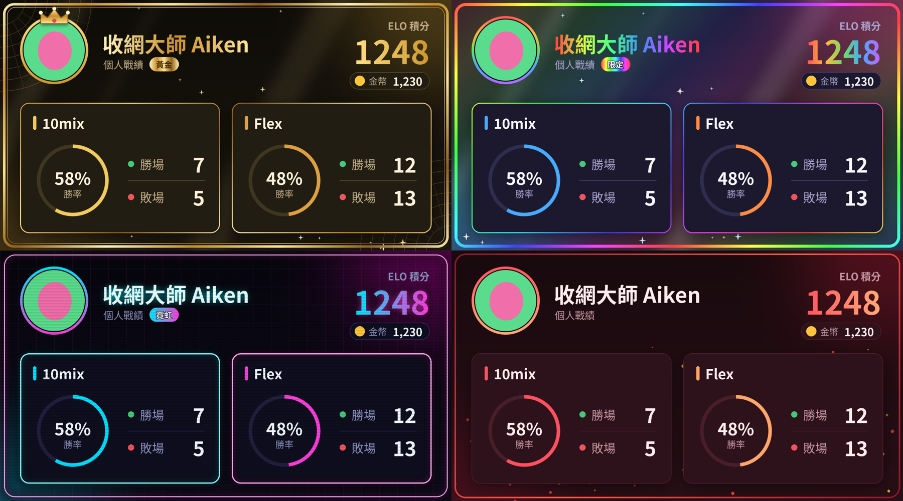
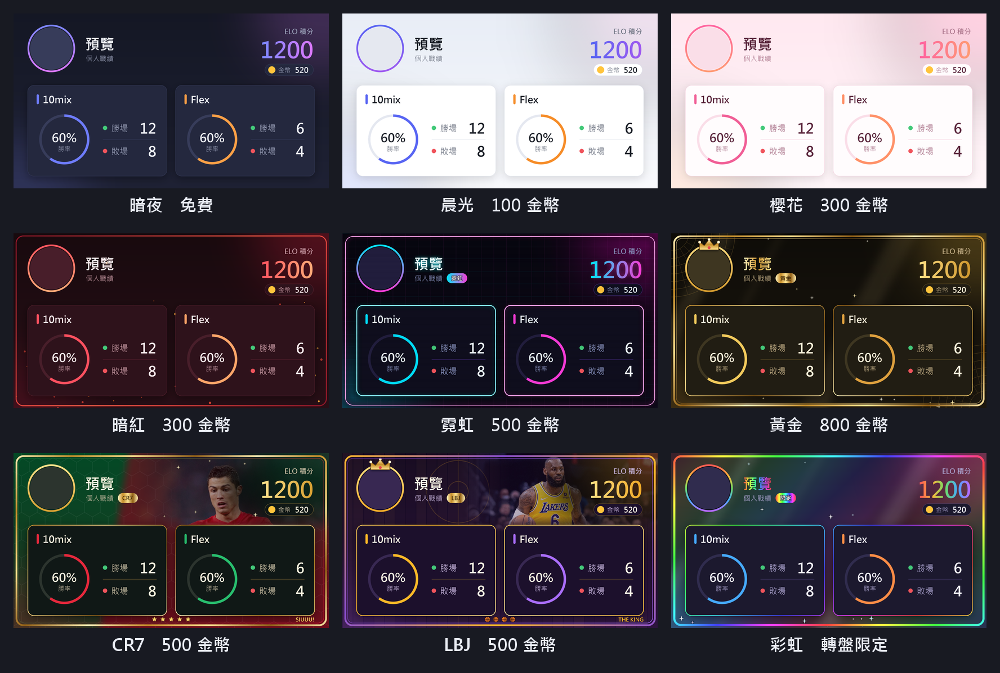
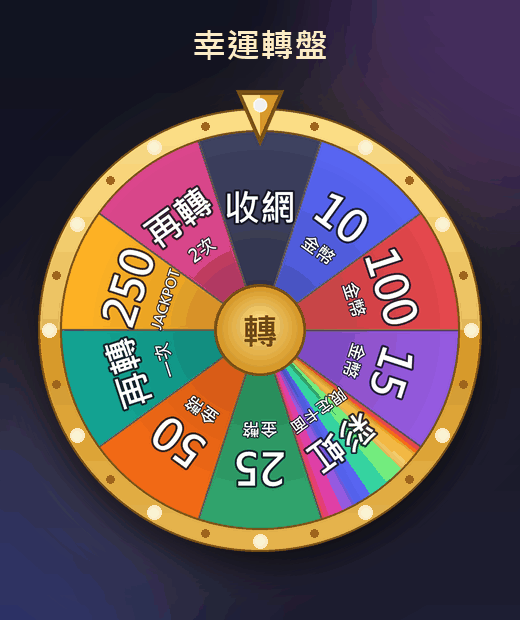
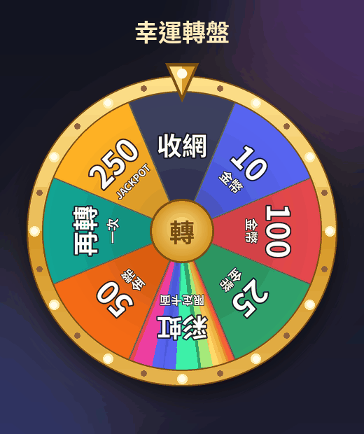
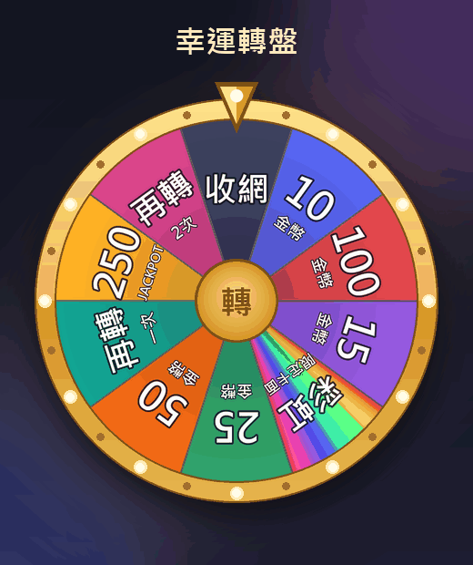

# 收網機械人



## 功能一覽

### 自動回覆
- 訊息有「冠」或「魔」字，bot 會回覆「收網」

### 10mix 排隊
- `/join`：加入排隊，滿 10 人自動開賽，按 ELO 分成最平均的兩隊
- `/leave`：離開排隊
- `/queue`：查看排隊名單

### 記錄結果
- `/result 10mix 編號 勝方`：按兩隊實力差距加減 ELO（實力相同 ±20）
- `/result flex p1~p5 贏/輸`：記錄 5 人 Flex 結果，每人 ±20（結果只有自己看到）
- `/cancel 編號`：取消比賽，不計 ELO

### 自動記錄 Flex 積分場
- `/link 名字#TAG [玩家]`：連結 Riot 帳號（只有自己看到）；可以幫未連結嘅人連結，已連結嘅只有本人或 bot 擁有者可以更改；`/unlink` 取消
- Bot 每 5 分鐘檢查已連結成員嘅 **Flex 積分場**：同一隊有 **2 人或以上**已連結成員，就會自動記錄勝負（ELO ±20、金幣），並喺指定頻道公佈每人用咩英雄同 KDA
- `/flexchannel`：喺想公佈結果嘅頻道用（只限 bot 擁有者）
- 只計連結之後打嘅場；重開（remake）唔計；10mix 自訂房 Riot 冇提供資料，仍然要用 `/result 10mix`
- 需要喺 `.env` 加入 `RIOT_API_KEY=`（喺 developer.riotgames.com 申請）

### 統計
- `/stat [玩家]`：個人戰績卡（ELO、金幣、10mix 及 Flex 勝負與勝率），用你套用咗嘅卡面畫出嚟
- `/leaderboard`：ELO 前 10 名
- `/duo 最強/炸裂 [玩家]`：和某人同隊時勝率最高／最低的隊友
- `/lineup 最強/炸裂`：勝率最高／最低的 5 人陣容

上面嘅示範圖係四款特效卡面：黃金（左上）、彩虹（右上）、霓虹（左下）、暗紅（右下）。

### 金幣與卡面
- 每人起始 100 金幣
- 每場比賽（10mix 及 Flex）：贏 +20 金幣，輸 +5 金幣
- `/shop`：戰績卡商店（只有自己看到），有兩個按鈕：
  - 🛒 **購買**：買基本卡面
  - 🎨 **更換卡面**：喺下拉選單揀你擁有嘅卡面（包括英雄卡），會先顯示卡面預覽，再按「套用」

### 英雄卡
- 每位 League of Legends 英雄（現時 173 位）都有一張專屬戰績卡：英雄原畫、英雄名、稱號、地區同職業，顏色按原畫自動配搭
- 每個地區有自己嘅外框同特效：諾克薩斯鋼甲、蒂瑪西亞金翼、愛歐尼亞花瓣、弗雷爾卓德冰柱雪花、闇影島幽魂、皮爾托福齒輪、佐恩毒液泡泡、蘇瑞瑪太陽、巨石峰星空、比爾吉沃特麻繩海浪、伊克斯塔爾葉片、虛空裂痕、班德爾城星星、符文大地符文陣
- 用 `/spin` →「英雄卡轉盤」抽，**必定抽到你未擁有嘅英雄卡**；**第一次免費**，之後每次 300 金幣；抽中後會顯示張卡嘅預覽
- 新英雄推出後會自動加入

| 卡面 | 價錢 | 特效 |
|---|---|---|
| 暗夜 | 免費 | – |
| 晨光 | 100 金幣 | – |
| 櫻花 | 300 金幣 | – |
| 暗紅 | 300 金幣 | 火花粒子、紅色外框 |
| 霓虹 | 500 金幣 | 霓虹發光外框、網格背景、掃描線、「霓虹」徽章 |
| 黃金 | 800 金幣 | 頭像皇冠、金箔名字及外框、裝飾藝術花紋、閃光、「黃金」徽章 |
| CR7 | 500 金幣 | C 朗相片、葡萄牙紅綠背景、足球六角紋、金色外框、五粒星、SIUUU!、「CR7」徽章 |
| LBJ | 500 金幣 | 勒邦占士相片、湖人紫金配色、木地板同球場線、頭像皇冠、四個籃球（四冠）、THE KING、「LBJ」徽章 |
| 彩虹 | 轉盤限定 | 全息彩虹背景、彩虹名字及外框、閃光、「限定」徽章 |



### 轉盤
- `/spin`：打開轉盤選單（只有自己看到），揀 🎡 **幸運轉盤** 或 🎰 **英雄卡轉盤**，會顯示轉盤預覽同你嘅免費次數，再按「轉！」；轉盤動畫同結果會發送到頻道
- 幸運轉盤：每日 1 次免費（香港時間 00:00 重置），之後每次 25 金幣；結果唔同有唔同慶祝效果（金幣雨、彩紙、閃光等）

| 獎品 | 機率 |
|---|---|
| 收網（甚麼都沒有） | 24.5% |
| 10 金幣 | 24% |
| 15 金幣 | 16% |
| 25 金幣 | 14% |
| 50 金幣 | 8% |
| 100 金幣 | 4% |
| 再轉一次 | 6% |
| 再轉2次 | 2% |
| 250 金幣 Jackpot | 1% |
| 限定卡面「彩虹」（超級 Jackpot） | 0.5% |

已經擁有彩虹卡面再抽中，會換成 250 金幣。平均每轉回報約 22.3 金幣。

| 收網 | Jackpot | 超級 Jackpot |
|:---:|:---:|:---:|
|  |  |  |

### 管理
- `/setelo 玩家 數值`：直接修改 ELO（只限 bot 擁有者）
- `/givecoins 玩家 數量`：送金幣給玩家（只限 bot 擁有者）
- `/givecard 玩家 卡面`：送卡面給玩家，可以打字搜尋（例如 達瑞斯 / Darius / 黃金），頻道會公佈並顯示卡面預覽（只限 bot 擁有者）

## 安裝及運行

1. 安裝 Python 3.10 或以上，然後安裝套件：
   ```
   pip install -r requirements.txt
   ```
2. 喺專案資料夾建立 `.env` 檔案，填入 Discord bot token：
   ```
   DISCORD_TOKEN=你的token
   ```
3. 運行：
   ```
   python bot.py
   ```

戰績卡需要中文字型：Windows 會用微軟正黑體，macOS 用蘋方，Linux 需要安裝 Noto Sans CJK。

---

CR7 卡面相片：[Argentine - Portugal - Cristiano Ronaldo.jpg](https://commons.wikimedia.org/wiki/File:Argentine_-_Portugal_-_Cristiano_Ronaldo.jpg)，攝影：Ludovic Péron，授權：[CC BY-SA 3.0](https://creativecommons.org/licenses/by-sa/3.0/)（已裁剪及調色）。

LBJ 卡面相片：[LeBron James dribbling (March 21, 2022).jpg](https://commons.wikimedia.org/wiki/File:LeBron_James_dribbling_(March_21,_2022).jpg)，攝影：Erik Drost，授權：[CC BY 2.0](https://creativecommons.org/licenses/by/2.0/)（已裁剪及調色）。

收網機械人 isn't endorsed by Riot Games and doesn't reflect the views or opinions of Riot Games or anyone officially involved in producing or managing Riot Games properties. Riot Games, and all associated properties are trademarks or registered trademarks of Riot Games, Inc.
